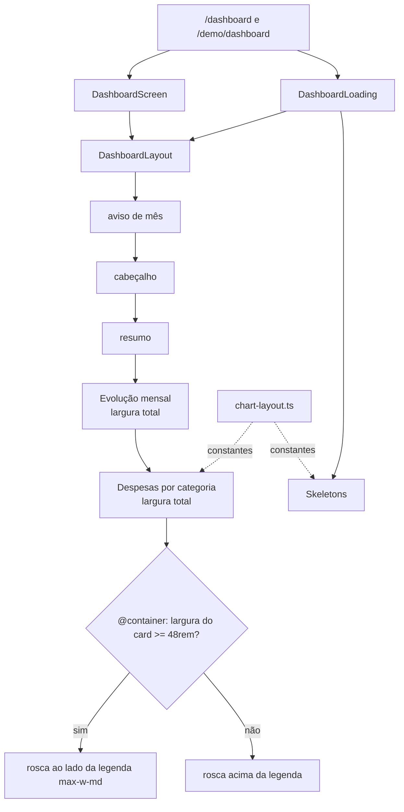

# ADR 0012 - Dashboard: "Despesas por categoria" abaixo da evolução mensal e legenda contida no card

- **Status:** **Aceito** em 2026-11-02. Implementado e aprovado pelo code-reviewer. O texto abaixo é o da proposta, com `donut-layout.ts` corrigido para `chart-layout.ts`; o que o código faz de diferente está no §13 (divergências).
- **Data:** 2026-11-02
- **Spec:** `docs/specs/dashboard-donut-abaixo-do-grafico.md` (RF01-RF17, RNF01-RNF07, CA01-CA16, B1-B3, TQ1-TQ5, PA1-PA7)
- **Base:** `docs/adr/0001-lancamentos-financeiros.md` (RF17/D4 do donut), `docs/adr/0002-lancamentos-financeiros-fechamento.md` (destaque pela legenda, `prefers-reduced-motion`), `docs/adr/0004-superficies-vidro-fosco.md` (cards em vidro, CLS ≤ 0,01), `docs/adr/0005-autenticacao-autorizacao-demo.md` §9.6 (`DashboardScreen` único para protegido e demo).
- **Escopo:** só `web/`. **Nenhuma** mudança em `api/`, contratos HTTP, Prisma, schema, migrations ou `mobile/`.
- **Autor:** architect

---

## 1. Contexto

Bugfix de layout. Fatos verificados no código:

1. `web/features/dashboard/dashboard-screen.tsx` coloca os dois cards de gráfico num grid `lg:grid-cols-12` (8/4) dentro da coluna externa `flex flex-col gap-4 md:gap-6`. `dashboard-loading.tsx` repete **à mão** o mesmo grid.
2. `web/features/dashboard/_components/category-donut.tsx` decide o arranjo interno por **breakpoints de viewport** (`flex-col md:flex-row lg:flex-col xl:flex-row`), calibrados para um card de 4/12. Em `xl` o card é estreito, volta a `flex-row` e a legenda transborda.
3. No item da legenda: o nome é `min-w-0 flex-1 truncate` (ok); `Money` (`web/components/ui/money.tsx`) já tem `whitespace-nowrap`, mas **não** tem `shrink-0`; o percentual é `w-14 text-right`, sem `shrink-0` nem `whitespace-nowrap`. Valor e percentual encolhem/vazam em vez de forçar o nome a truncar.
4. O skeleton **já diverge** da tela (prova do risco R6 da spec):
   - `DonutSkeleton` desenha a rosca com 200 px; a rosca real tem 220 px;
   - `ChartSkeleton` usa `h-[260px] lg:h-[320px]`; o gráfico real usa `h-[260px] md:h-[280px] lg:h-[320px]` (`monthly-chart.tsx` l. 306);
   - os skeletons usam `p-5` fixo; `ChartCard` usa `p-4 md:p-5`.
5. Tailwind instalado: **4.3.3** (`web/node_modules/tailwindcss/package.json`). Container queries são **nativas** no Tailwind 4 (`@container`, variantes `@sm:`…`@7xl:`, `@max-*:` e arbitrárias `@[40rem]:`), sem plugin. Nenhum arquivo do `web` usa container query hoje.
6. O stub já tem o cenário `custom` (`web/e2e/stub-api/server.mjs`, `SCENARIOS.custom`), que recebe `entries` e `demo: { cards, entries }` do próprio teste via `setScenario("custom", …)` (`web/e2e/support.ts`), e a distribuição por categoria é **calculada** a partir dos lançamentos (`categoryDistribution`). Não existe `failMode` por endpoint do dashboard (só `"all"`).

---

## 2. Bounded context e linguagem ubíqua

**Bounded context:** *Apresentação / Dashboard* do `web`. Não há regra de negócio nova, dado novo nem contrato novo; o contexto financeiro não é tocado. Vale a linguagem ubíqua da spec §2, com os acréscimos:

| Termo | Definição | Artefato |
|---|---|---|
| **Pilha do dashboard** | Ordem e espaçamento fixos dos blocos: aviso → cabeçalho → resumo → evolução mensal → despesas por categoria, um por linha, em largura total. | `DashboardLayout` |
| **Contêiner da rosca** | Elemento com `container-type: inline-size` que envolve rosca + legenda; o arranjo (lado a lado / empilhado) é decidido pela largura **dele**, não da viewport. | classe `@container` |
| **Ponto de troca** | Largura do contêiner da rosca a partir da qual o arranjo passa a lado a lado. | variante `@3xl:` (final; a proposta usava `@2xl`, §13) |

---

## 3. Premissas adotadas para B1-B3 (respostas padrão; valores finais pelo ui-designer)

| # | Premissa | Consequência técnica |
|---|---|---|
| **B1** | Lado a lado quando o **contêiner da rosca** tiver ≥ 42rem (672 px, variante padrão `@2xl`); empilhado abaixo disso. No lado a lado: legenda à direita, centralizada verticalmente, largura máxima `max-w-md` (28rem, 448 px), bloco rosca + legenda centralizado no card. No empilhado: legenda em largura total do card. | §5.2. O ui-designer pode trocar o ponto de troca por **outro passo padrão** da escala de container (`@xl` = 36rem, `@3xl` = 48rem) e o `max-w-*`, sem mudar o mecanismo. Valor arbitrário (`@[NNrem]`) só com justificativa no design. |
| **B2** | Rosca com 220 px em todos os arranjos. | `DonutSkeleton` passa a 220 px (corrige o fato 4). |
| **B3** | Barras mantêm `h-[260px] md:h-[280px] lg:h-[320px]`; só a largura muda. | A altura vira constante exportada e compartilhada com `ChartSkeleton` (§5.3). |

Cálculo de referência do ponto de troca (pior caso, `text-sm`): rosca 220 + `gap-8` 32 + legenda mínima utilizável ≈ 330 (marcador 12 + gaps 24 + nome mínimo ~80 + "R$ 9.999.999.999,99" ~150 + percentual 56) ≈ 582 px. `@2xl` (672 px) deixa folga para o nome. Como o breakpoint de container é em `rem`, com o `font-size` raiz dobrado (CA12) o ponto de troca dobra junto e o card empilha mais cedo, que é o comportamento desejado.

---

## 4. Modelo

Não há domínio no sentido da `api`: nenhum aggregate, entity, value object, domain event, repositório, port ou use case. A ausência é intencional. Dados, agrupamento (`groupCategories`) e formatação (`Money`, `formatPercent`) **não mudam** (RF16). A única "regra" nova é de apresentação e fica concentrada em pontos únicos (§5.3): a ordem/espaçamento da pilha (`DashboardLayout`) e as classes do arranjo da rosca (`chart-layout.ts`).

---

## 5. Decisões técnicas

### 5.1 TQ1 - Como testar "não transbordar"

**Decisão:** duas camadas, cada uma no que sabe verificar.
- **Vitest (jsdom):** estrutura e classes: ordem dos blocos no DOM, ausência de colunas lado a lado, uso do contêiner, regras de encolhimento do item da legenda, skeleton com o mesmo arranjo (CA01, CA02, CA04 estrutural, CA09-CA11 no nível de classe).
- **Playwright (build de produção + stub):** a garantia real: `boundingBox`, `scrollWidth`/`clientWidth` e `document.documentElement.scrollWidth` nas larguras do RNF01 (CA03, CA05, CA07-CA12, CA14, CA15). Detalhes no §9.

### 5.2 TQ2 - Container query, não viewport

**Decisão:** o arranjo interno do donut passa a depender da largura do card via `@container` do Tailwind 4.3 (nativo, sem plugin, sem dependência nova). Nenhuma variante de viewport (`md:`/`lg:`/`xl:`) no arranjo rosca + legenda.

Estrutura no modo "Gráfico" de `CategoryDonut` (classes de referência; ponto de troca e `max-w` finais vêm do ui-designer):

```
div.@container                                  ← contêiner (largura do card)
  div  flex flex-col items-center gap-4
       @3xl:flex-row @3xl:justify-center @3xl:gap-8
    div  relative h-[220px] w-[220px] shrink-0  ← rosca (inalterada)
    ul   flex w-full min-w-0 max-w-md flex-col gap-2 text-sm
         @3xl:flex-1
```

> Valores finais: ponto de troca `@3xl` (48rem) e `max-w-md` nos dois arranjos (ver §13). O texto da proposta citava `@2xl`.

- O `@container` fica num `div` **dentro** de `CategoryDonut` (só no ramo "Gráfico"), não em `ChartCard`: o `ChartCard` também emoldura a evolução mensal e não deve carregar uma decisão de layout de um gráfico só (SRP). Um elemento não consulta o próprio contêiner, por isso são dois `div`.
- `container-type: inline-size` num bloco que já estica na largura do `figure` não altera o tamanho de nada; não cria `overflow: hidden`, então o tooltip do Recharts continua visível.
- Estado vazio e "Tabela" não usam o contêiner: o vazio já é coluna centralizada (RF15) e a tabela já rola em `overflow-x-auto` (RF14).
- **Descartado:** breakpoints de viewport recalibrados (`md:flex-row` sem `lg:`/`xl:`). Funcionaria hoje, mas repete a causa raiz do defeito: o componente volta a "saber" em que coluna o pai o coloca (R5). Também não reage ao zoom de texto como a container query em `rem`.

### 5.3 TQ3 - Pilha simples, compartilhada entre tela e skeleton

**Decisão:** remover o grid interno 8/4. Os dois cards viram filhos diretos da coluna externa `flex flex-col gap-4 md:gap-6`, que passa a ser **um componente de layout** usado por `DashboardScreen` e `DashboardLoading`.

```ts
// web/features/dashboard/_components/dashboard-layout.tsx (Server Component, sem estado)
export interface DashboardLayoutProps {
  notice?: ReactNode;      // MonthNotice (só na tela)
  header: ReactNode;       // DashboardHeader | <h1>Dashboard</h1>
  summary: ReactNode;
  monthly: ReactNode;      // bloco "Evolução mensal" (com UpdatingRegion/BlockErrorBoundary/Suspense na tela)
  categories: ReactNode;   // bloco "Despesas por categoria"
}
/** Pilha do dashboard (ADR 0012): um bloco por linha, largura total, ordem fixa (RF01-RF04). */
export function DashboardLayout(props: DashboardLayoutProps): JSX.Element;
```

- Os slots `monthly` e `categories` são envolvidos por `div.min-w-0` (protege contra filhos com `min-width` intrínseco, como a tabela da evolução mensal). Sem `order-*`, `*-reverse`, `col-*`/`row-*` (CA01, CA02).
- `UpdatingRegion` e `BlockErrorBoundary` de cada bloco continuam na tela, dentro do slot (RF06). O `h-full` das `UpdatingRegion` dos painéis sai (servia para igualar alturas lado a lado; não há mais irmão na linha).
- **Espaçamento (RF04/PA6):** passa a ser o da coluna externa (`gap-4`, `md:gap-6`). Entre 768 e 1023 px o espaço entre os dois cards sobe de 16 para 24 px, igualando-se ao espaço entre os demais blocos. O ui-designer confirma; se quiser manter 16 px nessa faixa, é ajuste de classe no `DashboardLayout`, num ponto só.
- **Arranjo interno compartilhado com o skeleton:** novo módulo `web/features/dashboard/_components/chart-layout.ts` (sem `"use client"`, pois os skeletons são Server Components) com as strings de classe do §5.2 (classes **literais completas**, para o scanner do Tailwind):

```ts
export const DONUT_CONTAINER: string;   // "@container"
export const DONUT_ARRANGEMENT: string; // "flex flex-col items-center gap-4 @2xl:flex-row ..."
export const DONUT_RING: string;        // "relative h-[220px] w-[220px] shrink-0"
export const DONUT_LEGEND: string;      // classes da ul
```

  `CategoryDonut` e `DonutSkeleton` usam as mesmas constantes. O skeleton passa a ter rosca de 220 px e **6** linhas de legenda (máximo real: 5 + "Outras"), com o mesmo `p-4 md:p-5` do `ChartCard`.
- **Altura das barras compartilhada:** `monthly-chart.tsx` exporta a constante de altura que hoje é local (`MONTHLY_CHART_HEIGHT = "h-[260px] md:h-[280px] lg:h-[320px]"`) e `ChartSkeleton` a usa (corrige o `md:h-[280px]` ausente; CA04/RNF03).
- **Descartados:** (a) manter `grid lg:grid-cols-12` com `lg:col-span-12` nos dois: grid sem função, convida a reintroduzir colunas; (b) constante só de classes do grid: não fixa a **ordem** dos blocos, e a ordem é o que CA01 exige igual nos dois.

### 5.4 TQ4 - Valor e percentual não encolhem

**Decisão** (item `li` da legenda):

| Parte | Classes |
|---|---|
| `li` | `flex flex-wrap items-center gap-x-2 gap-y-0.5 rounded-md px-1 py-1` (+ destaque atual) |
| marcador | inalterado (`h-3 w-3 shrink-0`) |
| nome | `min-w-0 flex-1 basis-0 truncate` (`title` de "Outras" inalterado) |
| valor | `<Money className="shrink-0 text-text" />` (o `whitespace-nowrap` já vem do `Money`) |
| percentual | `min-w-14 shrink-0 whitespace-nowrap text-right text-muted` (`min-w-14` em vez de `w-14`: alinha a coluna e nunca corta "100,00%" com zoom de texto) |

- `flex-wrap` é **rede de segurança** para PA2, não o comportamento normal: como o nome tem base 0 e `min-w-0`, a linha só quebra se marcador + valor + percentual, sozinhos, não couberem (perto de 320 px com zoom). Nesse caso o percentual (ou o valor) desce para a segunda linha **dentro** do item, nunca para fora do card. Em 360 px com o pior caso o item fica em uma linha (CA09).
- `ul` com `min-w-0 max-w-full` (§5.2).
- Não se altera o `Money` global (já é `whitespace-nowrap`); `shrink-0` é decisão do contexto de uso, não do componente.

### 5.5 TQ5 - Dados de pior caso

**Decisão:** os **dados** de pior caso **não** entram em `server.mjs`. O e2e usa o cenário existente `custom` com um fixture próprio, `web/e2e/dashboard-worst-case.ts`, montado com `pixExpense` de `web/e2e/entries-data.ts`:

```ts
/** Pior caso do donut (CA08): 7+ categorias (5 + "Outras") com nomes de 60 caracteres sem espaço e valor no limite de Decimal(12,2). */
export function worstCaseEntries(month: string): unknown[];
/** Uma categoria só: percentual "100,00%" (string de percentual mais larga). */
export function singleCategoryEntries(month: string): unknown[];
// uso: setScenario("custom", { now, entries: worstCaseEntries(M), demo: { cards: [], entries: worstCaseEntries(M) } })
```

- Os nomes são distintos (prefixo numérico + 58 caracteres) para não colidirem no agrupamento.
- "Valor máximo" e "100,00%" não coexistem em 6 itens; por isso dois conjuntos: o primeiro maximiza a largura do valor, o segundo a do percentual. "0,01%" é coberto adicionando ao primeiro uma categoria de valor pequeno dentro de "Outras" (não aparece na legenda; aparece na tabela, CA14).
- `demo.entries` cobre `/demo/dashboard` (CA06) com os mesmos dados.
- **Descartado:** cenário nomeado de pior caso em `SCENARIOS`: duplica o que `custom` já faz e acopla o stub a um teste. Regra adotada para o stub: **cenário novo só quando o comportamento muda, não os dados**.
- **Única mudança no stub (comportamento, CA05):** dois cenários de falha isolada, `"category-distribution-error"` (`failMode: "category-distribution"`) e `"monthly-evolution-error"` (`failMode: "monthly-evolution"`), cada um derrubando só o GET correspondente (500), no protegido e na demo. `page.route` não serve, porque a leitura é feita no servidor do Next.

---

## 6. Endpoints e impacto no Next.js

- **API/HTTP:** nenhum endpoint, DTO ou erro novo/alterado.
- **Server actions:** nenhuma.
- **Páginas:** `/dashboard` e `/demo/dashboard` mudam só pelo `DashboardScreen`/`DashboardLoading` compartilhados (RF07). Nenhuma rota, `loading.tsx` ou `page.tsx` novo; os `loading.tsx` existentes continuam renderizando `DashboardLoading`.
- **Componentes:** `DashboardLayout` é Server Component sem estado; `CategoryDonut` continua `"use client"`. Nenhuma fronteira cliente/servidor muda.

## 7. Prisma, schema e migrations

Nenhuma mudança.

## 8. Arquivos

| Arquivo | Mudança |
|---|---|
| `web/features/dashboard/_components/dashboard-layout.tsx` (novo) | Pilha com slots (§5.3). |
| `web/features/dashboard/_components/chart-layout.ts` (novo) | Classes do arranjo da rosca, `MONTHLY_CHART_HEIGHT` e `CHART_HEADER_SKELETON` (§5.2/§5.3, §13). |
| `web/features/dashboard/dashboard-screen.tsx` | Usa `DashboardLayout`; remove grid 8/4 e `h-full`. |
| `web/features/dashboard/dashboard-loading.tsx` | Usa `DashboardLayout` com os skeletons. |
| `web/features/dashboard/_components/category-donut.tsx` | `@container` + constantes; item da legenda (§5.4). Acessibilidade, tabela e vazio inalterados (RF13-RF15). |
| `web/features/dashboard/_components/dashboard-skeletons.tsx` | `DonutSkeleton` com as constantes, rosca 220 px, 6 linhas, `p-4 md:p-5`; `ChartSkeleton` com `MONTHLY_CHART_HEIGHT` e `p-4 md:p-5`. |
| `web/features/dashboard/_components/monthly-chart.tsx` | Só exporta `MONTHLY_CHART_HEIGHT`. |
| `web/e2e/stub-api/server.mjs` | Dois cenários de falha isolada (§5.5). |
| `web/e2e/dashboard-worst-case.ts`, `web/e2e/dashboard-layout.pw.ts` (novos) | §5.5, §9. |
| `docs/design/design-system.md` (ou doc do dashboard), `CHANGELOG.md` | RF17 / T9 (ui-designer e doc-writer). |

Nenhuma cor nova (RNF07). Nenhuma animação nova (RNF05): a troca de arranjo é só CSS de layout.

---

## 9. Plano de testes por camada

### 9.1 Vitest (componente, jsdom)

- **`dashboard-layout.spec.tsx` (novo):** renderiza os slots com marcadores e verifica a ordem no DOM (aviso → cabeçalho → resumo → evolução → categorias); o contêiner e os wrappers não têm classe que case com `/(^|:)(col-span-|col-start-|row-start-|order-|grid-cols-(?!1\b)|flex-row|flex-col-reverse)/` (CA01, CA02); `notice` ausente não renderiza wrapper vazio.
- **`dashboard-loading.spec.tsx` (novo):** "Carregando evolução mensal" antes de "Carregando despesas por categoria", ambos anunciados; nenhum ancestral com as classes proibidas (CA04 estrutural).
- **`dashboard-screen.spec.tsx` (novo):** com `vi.mock("./_components/dashboard-blocks")` devolvendo blocos síncronos (o jsdom não renderiza Server Components assíncronos) e um `FinanceReader` falso, verifica que o `figure` "Evolução mensal" precede "Despesas por categoria" e que o erro de um bloco (mock que lança) mostra a mensagem dele e mantém o outro (CA01, CA05 estrutural, RF06).
- **`dashboard.spec.tsx` (ampliar):** `CategoryDonut` no modo "Gráfico": existe ancestral com `@container` e o arranjo usa `@2xl:flex-row` (ou o passo escolhido) sem `md:`/`lg:`/`xl:` (CA10/CA11 nível de classe); em cada `li`, nome com `truncate min-w-0 flex-1`, valor e percentual com `shrink-0`, percentual com `whitespace-nowrap` (CA09); `aria-label` com nome completo (CA09). `DonutSkeleton`: mesmas classes de arranjo e rosca de 220 px; `ChartSkeleton` com `MONTHLY_CHART_HEIGHT`. Os casos atuais continuam verdes sem edição.
- **`charts-motion.spec.tsx`, `dashboard-blocks.spec.tsx`:** sem mudança, devem continuar verdes (CA13).
- Cobertura ≥ 80% em `features/**` (já no `coverage.include` de `vitest.config.mts`).

### 9.2 Playwright (build de produção + stub), `web/e2e/dashboard-layout.pw.ts` (novo)

Parametrizado por URL (`/dashboard?month=2026-11`, `/demo/dashboard?month=2026-11`), tema (claro/escuro) e viewport (320, 360, 390, 768, 1024, 1280, 1440, 1920). Helper local `assertInside(child, card)` compara as caixas com a caixa interna do `figure` (descontando o `padding` computado), tolerância de 1 px.

- **CA03:** caixas de "Evolução mensal", "Despesas por categoria" e do resumo com mesmo `x` e largura; topo do donut ≥ base das barras.
- **CA04:** `delayMs` no stub; skeletons empilhados em largura total; CLS por `PerformanceObserver('layout-shift')` na troca ≤ 0,01 (mesmo método do ADR 0004).
- **CA05:** cenários `category-distribution-error` e `monthly-evolution-error` (§5.5): o card com erro fica na posição dele, em largura total, e o outro aparece normalmente.
- **CA07-CA09:** fixture de pior caso (§5.5); todo `li` dentro do card; `ul.scrollWidth ≤ clientWidth`; `documentElement.scrollWidth ≤ innerWidth`; em 360 px o nome tem `scrollWidth > clientWidth` e `text-overflow: ellipsis`, valor e percentual `scrollWidth ≤ clientWidth`, `li` em uma linha. Em 320 px só a contenção é exigida (PA2).
- **CA10/CA11:** em 360 px, topo da `ul` ≥ base da rosca; em 1024/1440 px, legenda à direita da rosca (`ul.x ≥ rosca.x + rosca.width`) e `ul.width` ≤ o `max-w` definido.
- **CA12:** viewport 640 px com `document.documentElement.style.fontSize = "200%"`: sem transbordo, valor e percentual visíveis.
- **CA14/CA15:** "Tabela" em 360/1440 px sem rolagem da página; estado vazio (cenário `empty`) em largura total e centralizado.
- **CA16:** `a11y.pw.ts`, `glass.pw.ts`, `theme-charts.pw.ts`, `dark-theme.pw.ts` rodam sem afrouxar. Busca feita: nenhum deles mede a posição lado a lado dos cards do dashboard; ajuste esperado nenhum, o tester confirma na fase red (R7).

---

## 10. Violações de SOLID no código atual que afetam a feature

1. **DRY/SRP - layout duplicado entre tela e skeleton:** `dashboard-screen.tsx` e `dashboard-loading.tsx` repetem a estrutura à mão, e o skeleton já divergiu (rosca 200 vs 220 px, altura `md` das barras ausente, padding diferente; §1 fato 4). Correção: `DashboardLayout`, `chart-layout.ts` e `MONTHLY_CHART_HEIGHT` como fontes únicas.
2. **Acoplamento ao contexto de uso (OCP/encapsulamento):** `CategoryDonut` decide o arranjo por breakpoints de viewport que pressupõem a coluna 4/12 do pai; mudar o pai quebra o filho (causa raiz do defeito). Correção: container query (§5.2).
3. **Regra de encolhimento implícita:** "o nome cede, valor e percentual não" não estava expresso no item da legenda. Correção: explícito no `li` (§5.4), sem alterar o `Money` global.
4. **SRP em `CategoryDonut` (registrado, não corrigido):** o componente concentra rosca, legenda, tabela e estado vazio. Não é dividido agora para manter o bugfix pequeno; se a legenda crescer de novo, extrair `DonutLegend`.

---

## 11. Alternativas descartadas e trade-offs

| Alternativa | Motivo do descarte |
|---|---|
| Breakpoints de viewport recalibrados | Repete a causa raiz (R5); não acompanha zoom de texto. |
| `@container` no `ChartCard` | Põe decisão de um gráfico na moldura comum aos dois. |
| Grid de 12 colunas com `col-span-12` | Estrutura sem função; facilita reintroduzir colunas. |
| Cenário nomeado de pior caso no stub | `custom` já recebe dados do teste. |
| Legenda sempre empilhada (como no mobile) | Funciona, mas desperdiça o card de ~1400 px e alonga a página (R4/R8). Fica como plano B se o ui-designer preferir. |
| `w-14` fixo no percentual | Corta com zoom de texto; `min-w-14` mantém o alinhamento. |

Trade-offs aceitos:
- Primeira container query do projeto: um conceito a mais no design system (registrar no RF17).
- Espaço entre os dois cards em 768-1023 px passa de 16 para 24 px (uniforme com o resto), salvo decisão contrária do ui-designer.
- `flex-wrap` no item: em larguras extremas o percentual pode ir para a segunda linha do item (PA2).

---

## 12. Riscos remanescentes

- Ponto de troca e `max-w` dependem do ui-designer; trocar os valores não muda o mecanismo nem os testes, que usam as constantes de `chart-layout.ts` e medem caixas.
- O total no centro da rosca **entrou no escopo** por decisão do usuário (a proposta o deixava fora); ver §13.
- **Pendência de verificação:** o Playwright (`web/e2e/dashboard-layout.pw.ts`, 68 testes) não rodou no ambiente de desenvolvimento (falta `libnspr4.so`). Os 4 specs vitest novos foram aprovados na revisão; os critérios medidos por caixa (CA03, CA05, CA07-CA12, CA14, CA15) precisam ser executados em CI ou em máquina com as bibliotecas do Chromium antes de considerar a verificação completa.
- Se o card de donut voltar a ficar estreito no futuro, o arranjo se ajusta sozinho (container query); só o CA03 (largura total) falharia, como deve.

---

## 13. Divergências entre a proposta e o código final

| Tema | Proposta (§) | Código final |
|---|---|---|
| Ponto de troca | `@2xl` (42rem), §3 B1 e §5.2 | **`@3xl` (48rem)**, decisão do usuário, validada no design. Em 768 px de viewport o contêiner mede ~678 px: sempre empilhado, sem depender da barra de rolagem. Classes reais: arranjo `flex flex-col items-center gap-4 @3xl:flex-row @3xl:justify-center @3xl:gap-8`; legenda `flex w-full min-w-0 max-w-md flex-col gap-2 text-sm @3xl:flex-1`. |
| Total no centro da rosca | Fora do escopo, §12 | **Dentro do escopo.** Fonte pelo `length` de `formatBRL`: ≤ 13 `text-lg`; ≤ 15 `text-base`; ≤ 17 `text-sm`; senão `text-xs`. Motivo: `.money` usa JetBrains Mono (0,6em por caractere) e o furo mede ≈ 149,6 px. |
| Tooltip da fatia | Não previsto | Nome com `break-words` (nomes de 60 caracteres sem espaço passavam da caixa). |
| Módulo de constantes | `donut-layout.ts` com 4 constantes | `chart-layout.ts` com 6: `MONTHLY_CHART_HEIGHT`, `DONUT_CONTAINER`, `DONUT_ARRANGEMENT`, `DONUT_LEGEND`, `DONUT_RING`, `CHART_HEADER_SKELETON`. `MONTHLY_CHART_HEIGHT` mora ali (não é exportada de `monthly-chart.tsx`) e `DONUT_RING` não inclui `relative`. Sem `"use client"`. |
| Cabeçalho dos skeletons | Não detalhado | Cabeçalho comum igual ao `figcaption`: título `h-7` + subtítulo `h-5` sem gap (48 px); alternador `h-[46px]`; rosca de 220 px; `ChartSkeleton` com `MONTHLY_CHART_HEIGHT`. |
| Gap entre cards | Dúvida (PA6) | Confirmado: 16 px até 767 px, 24 px a partir de 768 px. |
| Stub e2e | Dois cenários de falha isolada | Implementado: `category-distribution-error` e `monthly-evolution-error`. |
| Testes | §9 | 4 specs vitest novos (`dashboard-layout`, `dashboard-loading`, `dashboard-screen`, `category-donut-layout`) e `e2e/dashboard-layout.pw.ts` (68 testes, não executado; ver §12). |

Nada mudou em `api/`, contratos HTTP, Prisma ou `mobile/`.

## 14. Diagrama do fluxo principal


