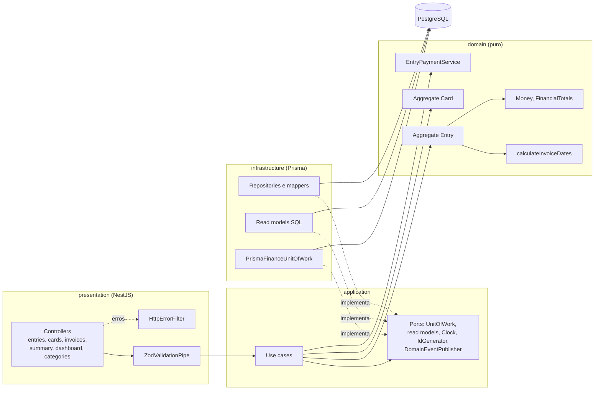
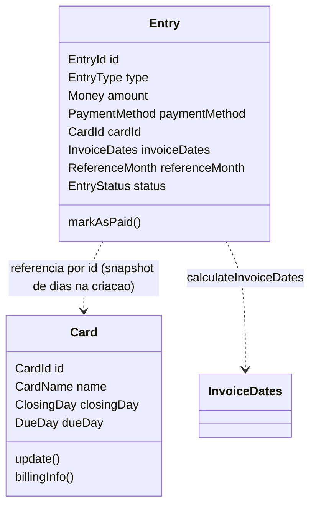
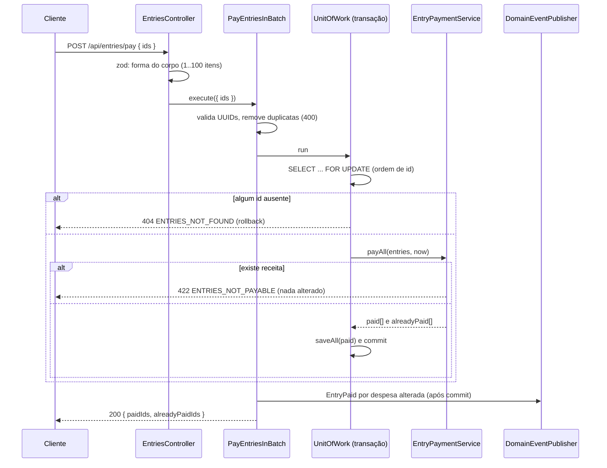
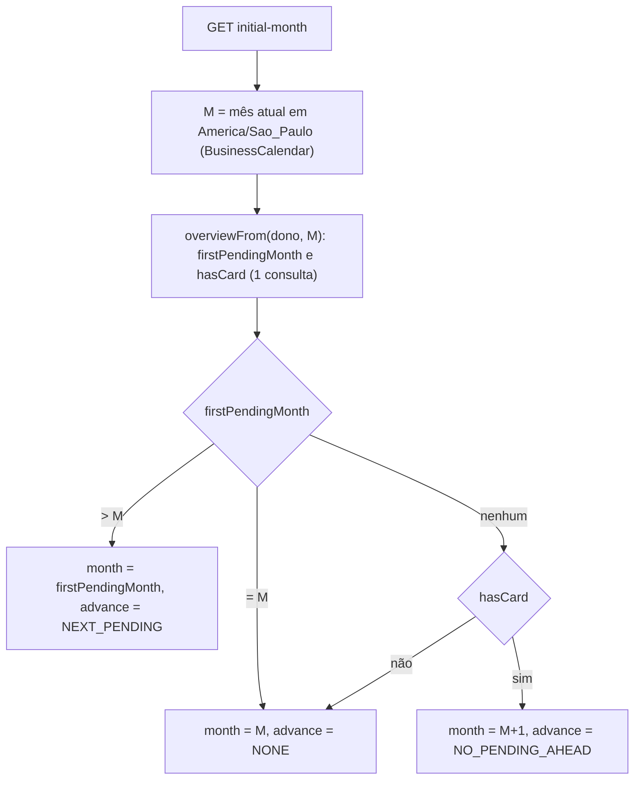
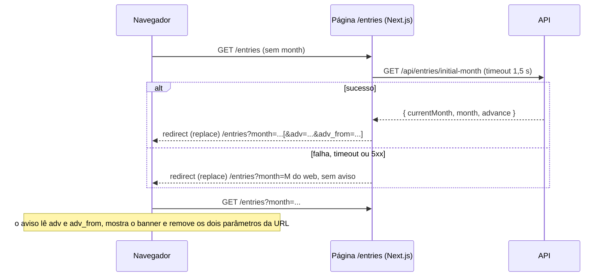

# API de finanças (lançamentos, cartões, faturas, resumo e dashboard)

Documenta o que o código implementa em `api/src/modules/finance/presentation/http` e `api/src/shared/presentation`. Decisões de desenho: `docs/adr/0001-lancamentos-financeiros.md`. Requisitos: `docs/specs/lancamentos-financeiros.md`.

## Convenções

- **Prefixo:** todas as rotas ficam sob `/api` (`configureApp`). A porta vem de `PORT` (padrão 3000; o web espera 3001, ver README).
- **Formato:** JSON (`Content-Type: application/json`). Todas as rotas, exceto as públicas `/api/demo/*` (somente leitura, dono fixo `DEMO_USER_ID`), exigem sessão válida; sem ela, 401 `UNAUTHENTICATED`, e com troca de senha pendente, 403 `PASSWORD_CHANGE_REQUIRED`. O dono dos dados é sempre o do principal (ou o usuário demo nas rotas `/api/demo/*`, que têm o mesmo contrato de resposta).
- **Dinheiro:** string decimal com 2 casas (`"1234.56"`); saldos podem ser negativos (`"-150.00"`). Nunca número JSON.
- **Datas:** `date`, `closingDate`, `dueDate` são datas civis `YYYY-MM-DD`; `referenceMonth` e `month` são `YYYY-MM`; instantes (`paidAt`, `createdAt`, `updatedAt`) são ISO 8601 em UTC.
- **IDs:** UUID (gerados em v7). Aceita-se qualquer UUID bem formado; bem formado e inexistente resulta em 404, mal formado em 400.
- **Texto:** `description`, `category` e `name` são normalizados (NFC e trim; `category` e `name` também colapsam espaços). Limites em code points: description 1-120, category 1-50, card name 1-50.
- **Faixa de datas/meses:** anos 1900 a 9998 (`OUT_OF_RANGE` fora disso), tanto em `date` quanto em `month`/`referenceMonth`.
- **Corpos e queries estritos:** campo desconhecido gera `UNKNOWN_FIELD`; parâmetro de query repetido gera `INVALID_TYPE`.

## Endpoints

| Método | Rota | Descrição | Sucesso |
|---|---|---|---|
| POST | `/api/entries` | Cria lançamento (receita ou despesa) | 201 |
| GET | `/api/entries/initial-month` | Mês inicial sugerido para a listagem de lançamentos (sem query) | 200 |
| GET | `/api/entries/expenses` | Despesas de um mês de referência, com filtros, paginação e subtotal | 200 |
| GET | `/api/entries/incomes` | Receitas de um mês de referência, com filtro de categoria, paginação e subtotal | 200 |
| POST | `/api/entries/:id/pay` | Marca uma despesa como paga (idempotente) | 200 |
| POST | `/api/entries/pay` | Paga várias despesas, tudo ou nada | 200 |
| GET | `/api/categories` | Categorias já usadas | 200 |
| POST | `/api/cards` | Cria cartão | 201 |
| GET | `/api/cards` | Lista cartões | 200 |
| PUT | `/api/cards/:id` | Substitui nome e dias do cartão | 200 |
| GET | `/api/invoices?month=[&status=]` | Faturas cujo mês de referência é `month`, opcionalmente só pendentes ou só pagas | 200 |
| GET | `/api/cards/:cardId/invoices/:referenceMonth/entries` | Despesas de uma fatura | 200 |
| POST | `/api/cards/:cardId/invoices/:referenceMonth/pay` | Paga as despesas pendentes da fatura | 200 |
| GET | `/api/summary?month=` | Resumo do mês (receitas, despesas, saldos) | 200 |
| GET | `/api/dashboard/monthly-series?month=` | 12 meses terminando em `month` | 200 |
| GET | `/api/dashboard/category-distribution?month=` | Despesas do mês por categoria | 200 |

Não existe edição nem exclusão de lançamentos, nem exclusão de cartões.

### Objeto `Entry` (resposta de criação, listagens e pagamento)

```json
{
  "id": "0192f3a4-6b1c-7d2e-8f90-a1b2c3d4e5f6",
  "type": "EXPENSE",
  "description": "Mercado",
  "category": "Alimentação",
  "date": "2026-10-15",
  "amount": "230.50",
  "paymentMethod": "CARD",
  "card": { "id": "0192f3a4-0000-7000-8000-000000000001", "name": "Nubank" },
  "invoice": { "closingDate": "2026-11-10", "dueDate": "2026-11-20" },
  "referenceMonth": "2026-11",
  "status": "PENDING",
  "paidAt": null,
  "createdAt": "2026-10-24T13:00:00.000Z",
  "updatedAt": "2026-10-24T13:00:00.000Z"
}
```

- `type`: `INCOME` | `EXPENSE`. `paymentMethod`: `PIX` | `CARD`. `status`: `PENDING` | `PAID` | `RECEIVED` (`RECEIVED` só para receitas).
- `card` e `invoice` são `null` quando a forma é `PIX` (e em toda receita).
- `referenceMonth` é calculado pela API e nunca muda (ver "Regras de negócio").

### Objetos de totais

- `ExpenseTotals`: `{ "total": "300.00", "paid": "100.00", "pending": "200.00" }` (`total = paid + pending`).
- `Totals` (resumo e série): `{ "income": "...", "expenses": ExpenseTotals, "balance": { "realized": "...", "projected": "..." } }`.
  - `balance.realized = income - expenses.paid`
  - `balance.projected = income - expenses.total`
  - Receitas com data futura entram no saldo realizado (regra B7).
- `pagination`: `{ "page": 1, "pageSize": 20, "totalItems": 45, "totalPages": 3 }`.

---

### POST /api/entries

Corpo (estrito):

| Campo | Tipo | Obrigatório | Regra |
|---|---|---|---|
| `type` | string | sim | `INCOME` ou `EXPENSE` |
| `description` | string | sim | 1-120 |
| `category` | string | sim | 1-50; a grafia canônica é a do primeiro uso (case-insensitive, acentos diferenciam) |
| `date` | string | sim | `YYYY-MM-DD`, data existente, ano 1900-9998 |
| `amount` | string | sim | decimal positivo, até 2 casas, máximo `9999999999.99` |
| `paymentMethod` | string | sim | `PIX` ou `CARD` |
| `cardId` | string ou null | só com `CARD` | UUID de cartão existente; `null` equivale a omitido |
| `paid` | boolean | não | só despesa PIX; `false` cria pendente |

Regras de consistência (todas viram `VALIDATION_ERROR` 400, acumuladas):

| Situação | Campo e código |
|---|---|
| Receita com `paymentMethod: CARD` | `paymentMethod: NOT_ALLOWED_FOR_INCOME` |
| Receita com `cardId` | `cardId: NOT_ALLOWED_FOR_INCOME` |
| Receita com `paid` (true ou false) | `paid: NOT_ALLOWED_FOR_INCOME` |
| `CARD` sem `cardId` | `cardId: REQUIRED` |
| `PIX` com `cardId` | `cardId: NOT_ALLOWED_FOR_PIX` |
| `CARD` com `paid: true` | `paid: NOT_ALLOWED_FOR_CARD` |

Status inicial: receita nasce `RECEIVED`; despesa PIX nasce `PAID` (com `paidAt` = instante da criação, mesmo com data futura) salvo `paid: false`; despesa no cartão nasce sempre `PENDING`. Campos como `status`, `referenceMonth` ou datas da fatura no corpo geram `UNKNOWN_FIELD`.

Exemplo (despesa PIX):

```http
POST /api/entries
{ "type": "EXPENSE", "description": "Aluguel", "category": "Moradia", "date": "2026-10-05",
  "amount": "1500.00", "paymentMethod": "PIX" }
```

```json
{
  "id": "0192f3a4-6b1c-7d2e-8f90-a1b2c3d4e5f6", "type": "EXPENSE", "description": "Aluguel",
  "category": "Moradia", "date": "2026-10-05", "amount": "1500.00", "paymentMethod": "PIX",
  "card": null, "invoice": null, "referenceMonth": "2026-10", "status": "PAID",
  "paidAt": "2026-10-24T13:00:00.000Z", "createdAt": "2026-10-24T13:00:00.000Z", "updatedAt": "2026-10-24T13:00:00.000Z"
}
```

Exemplo (despesa no cartão, ver resposta do objeto `Entry` acima):

```http
POST /api/entries
{ "type": "EXPENSE", "description": "Mercado", "category": "Alimentação", "date": "2026-10-15",
  "amount": "230.50", "paymentMethod": "CARD", "cardId": "0192f3a4-0000-7000-8000-000000000001" }
```

Erros: 400 `VALIDATION_ERROR`; 404 `CARD_NOT_FOUND` (cartão inexistente; só depois de passar a validação 400).

### GET /api/entries/initial-month

Rota pública equivalente: `GET /api/demo/entries/initial-month` (dono = usuário demo). Não aceita query: qualquer parâmetro gera 400 `VALIDATION_ERROR` com `UNKNOWN_FIELD`. Uma única consulta ao banco.

Regra (ADR 0007): `M` é o mês corrente em America/Sao_Paulo. Considera-se pendência uma despesa `PENDING` (PIX ou cartão) com mês de referência >= `M`; pendências anteriores a `M` não interferem.

| Situação | `month` | `advance` |
|---|---|---|
| Há pendência em `M` | `M` | `NONE` |
| Primeira pendência em mês > `M` | esse mês | `NEXT_PENDING` |
| Sem pendência e com cartão | `M+1` | `NO_PENDING_AHEAD` |
| Sem pendência e sem cartão | `M` | `NONE` |

```json
{ "currentMonth": "2026-10", "month": "2026-12", "advance": "NEXT_PENDING" }
```

O avanço não tem limite de distância (risco aceito: uma data digitada errada pode definir a abertura até a pendência ser paga). Erros: 400 (query informada), 401, 403 (rota protegida) e 500.

Exemplo de erro (parâmetro de query informado):

```http
GET /api/entries/initial-month?month=2026-10
```

```json
{ "code": "VALIDATION_ERROR", "message": "...", "details": { "fields": [{ "field": "month", "code": "UNKNOWN_FIELD", "message": "Campo não reconhecido." }] } }
```

Não há 404: a rota não recebe id, e a ausência de pendência é um resultado válido. O fluxo está em "Diagramas".

### GET /api/entries/expenses

Query (estrita): `month` (obrigatório, `YYYY-MM`), `status` (`PENDING` | `PAID`), `category` (case-insensitive), `cardId` (UUID de cartão ou `pix` para despesas sem cartão), `page` (1 a 1.000.000, padrão 1), `pageSize` (1 a 100, padrão 20). Filtros combinam com AND. `cardId` de cartão inexistente não gera 404: apenas devolve lista vazia.

Ordenação: `date` desc, `createdAt` desc, `id` desc. `subtotal` considera todas as despesas que atendem aos filtros (não só a página), lidos no mesmo snapshot da página.

```http
GET /api/entries/expenses?month=2026-11&status=PENDING&cardId=pix&page=1&pageSize=20
```

```json
{
  "month": "2026-11",
  "items": [ /* Entry */ ],
  "pagination": { "page": 1, "pageSize": 20, "totalItems": 1, "totalPages": 1 },
  "subtotal": { "total": "230.50", "paid": "0.00", "pending": "230.50" }
}
```

Observação: o resumo do mês (`/api/summary`) nunca é afetado por esses filtros.

### GET /api/entries/incomes

Query (estrita): `month` (obrigatório), `category`, `page`, `pageSize` (mesmas regras). Resposta igual à anterior, com `subtotal: { "total": "5000.00" }`.

### POST /api/entries/:id/pay

Sem corpo. Marca a despesa como paga e devolve o `Entry` atualizado. Idempotente: despesa já paga (inclusive PIX que nasceu paga) devolve 200 sem alterar `paidAt` nem `updatedAt`.

Erros: 400 (`id` com formato inválido, campo `id`), 404 `ENTRY_NOT_FOUND` (`details: { id }`), 422 `ENTRY_NOT_PAYABLE` se for receita (`details: { incomeIds: [id] }`).

### POST /api/entries/pay

Pagamento em lote, atômico (tudo ou nada), com lock de linhas em ordem de id.

```http
POST /api/entries/pay
{ "ids": ["0192f3a4-...-0001", "0192f3a4-...-0002"] }
```

```json
{ "paidIds": ["0192f3a4-...-0001"], "alreadyPaidIds": ["0192f3a4-...-0002"] }
```

- `ids`: 1 a 100 itens; duplicatas são ignoradas. Cada item deve ser UUID (`ids[0]: INVALID_FORMAT`); lista vazia gera `ids: EMPTY`; mais de 100, `ids: TOO_MANY_ITEMS`.
- Ordem de `paidIds` e `alreadyPaidIds` segue a ordem da requisição (sem duplicatas).
- Precedência: 400, depois 404 `ENTRIES_NOT_FOUND` (`details: { missingIds }`, todos os ausentes), depois 422 `ENTRIES_NOT_PAYABLE` (`details: { incomeIds }`, todas as receitas). Em qualquer erro nada é alterado.

### GET /api/categories

```json
{ "items": ["Alimentação", "Moradia", "Salário"] }
```

Uma grafia por categoria (a do primeiro uso, receitas e despesas), ordenada pela chave case-insensitive.

### POST /api/cards e PUT /api/cards/:id

Corpo (estrito, mesmo para criar e substituir): `{ "name": string, "closingDay": number, "dueDay": number }`. `name` 1-50; `closingDay` e `dueDay` inteiros de 1 a 31 (vencimento pode ser menor, igual ou maior que o fechamento). Nome é único, sem diferenciar maiúsculas de minúsculas (acentos diferenciam).

```json
{ "id": "0192f3a4-0000-7000-8000-000000000001", "name": "Nubank", "closingDay": 10, "dueDay": 20,
  "createdAt": "2026-10-24T13:00:00.000Z", "updatedAt": "2026-10-24T13:00:00.000Z" }
```

Erros: 400 `VALIDATION_ERROR` (nome `REQUIRED`/`TOO_LONG`; dias `NOT_INTEGER`/`OUT_OF_RANGE`); no PUT, 404 `CARD_NOT_FOUND`; 409 `CARD_NAME_TAKEN` (`details.fields[0] = { field: "name", code: "NAME_TAKEN", ... }`). PUT sem mudança efetiva é no-op (mantém `updatedAt`). Editar um cartão não altera lançamentos existentes: as datas da fatura ficam gravadas em cada lançamento.

### GET /api/cards

`{ "items": [ Card ] }`.

### GET /api/invoices?month=YYYY-MM[&status=PENDING|PAID]

Uma fatura por cartão que tenha despesas com aquele mês de referência (mês do vencimento). Ordenada por vencimento, nome do cartão e id. As datas exibidas são a maior `closingDate` e a maior `dueDate` entre as despesas da fatura (caso o cartão tenha sido editado no meio do ciclo).

```json
{
  "month": "2026-11",
  "items": [{
    "card": { "id": "0192f3a4-0000-7000-8000-000000000001", "name": "Nubank" },
    "referenceMonth": "2026-11",
    "closingDate": "2026-11-10",
    "dueDate": "2026-11-20",
    "entryCount": 3,
    "pendingCount": 2,
    "totals": { "total": "600.00", "paid": "100.00", "pending": "500.00" }
  }]
}
```

`status` é opcional (também em `GET /api/demo/invoices`). `PENDING` retorna só faturas com `pendingCount > 0`; `PAID`, só as com `pendingCount = 0`. O filtro seleciona a fatura inteira: `entryCount`, `pendingCount` e `totals` continuam sobre todas as despesas dela. Sem `status`, a resposta é a de sempre (todas). `ALL`, minúsculas ou qualquer outro valor geram 400 `VALIDATION_ERROR` com `fields: [{ field: "status", code: "INVALID_VALUE" }]`: "todas" é a ausência do parâmetro. A tela (web) usa `ALL` só na própria URL (`f_status`, `d_status`) e nunca o envia à API.

```http
GET /api/invoices?month=2026-11&status=PENDING
```

### GET /api/cards/:cardId/invoices/:referenceMonth/entries

```json
{ "card": { "id": "...", "name": "Nubank" }, "referenceMonth": "2026-11", "items": [ /* Entry */ ] }
```

Sem paginação, ordenada por `date` desc, `createdAt` desc, `id` desc. Cartão existente sem despesas no mês devolve `items: []`. Erros: 400, 404 `CARD_NOT_FOUND`.

### POST /api/cards/:cardId/invoices/:referenceMonth/pay

Paga, em uma transação, todas as despesas `PENDING` do cartão com esse mês de referência. Sem pendências: 200 com `paidCount: 0`.

```json
{ "cardId": "...", "referenceMonth": "2026-11", "paidIds": ["..."], "paidCount": 2, "paidAmount": "500.00" }
```

Erros: 400 (`cardId`/`referenceMonth` inválidos), 404 `CARD_NOT_FOUND`.

### GET /api/summary?month=YYYY-MM

```json
{
  "month": "2026-11",
  "totals": {
    "income": "5000.00",
    "expenses": { "total": "600.00", "paid": "100.00", "pending": "500.00" },
    "balance": { "realized": "4900.00", "projected": "4400.00" }
  }
}
```

### GET /api/dashboard/monthly-series?month=YYYY-MM

Série contínua de 12 pontos (de `month - 11` até `month`), com zeros nos meses sem lançamentos.

```json
{ "from": "2025-12", "to": "2026-11", "points": [ { "month": "2025-12", "totals": { /* Totals */ } } ] }
```

### GET /api/dashboard/category-distribution?month=YYYY-MM

Somente despesas do mês de referência, agrupadas por categoria (chave case-insensitive), em ordem decrescente de total. `percentage` é string com 2 casas. Mês sem despesas: `total: "0.00"` e `items: []`.

```json
{ "month": "2026-11", "total": "600.00",
  "items": [ { "category": "Alimentação", "total": "450.00", "percentage": "75.00" } ] }
```

---

## Erros

Formato único: `{ "code": string, "message": string, "details": unknown }`. `message` é texto em pt-BR para exibição; a lógica deve usar `code`. Erros de campo trazem `details.fields[]` com `{ field, code, message }` (nomes de campo como `ids[2]`, `amount`).

| HTTP | `code` | Quando | `details` |
|---|---|---|---|
| 400 | `VALIDATION_ERROR` | Corpo, query, path param ou regra de entrada inválidos | `{ fields: [...] }` |
| 400 | `MALFORMED_JSON` | JSON do corpo ilegível | `null` |
| 404 | `ROUTE_NOT_FOUND` | Rota inexistente | `{ method, path }` |
| 404 | `ENTRY_NOT_FOUND` | Lançamento inexistente (`POST /entries/:id/pay`) | `{ id }` |
| 404 | `ENTRIES_NOT_FOUND` | Algum id do lote inexistente | `{ missingIds }` |
| 404 | `CARD_NOT_FOUND` | Cartão inexistente (criar lançamento, PUT cartão, faturas) | `{ id }` |
| 409 | `CARD_NAME_TAKEN` | Nome de cartão já usado | `{ fields: [{ field: "name", code: "NAME_TAKEN", ... }] }` |
| 413 | `PAYLOAD_TOO_LARGE` | Corpo grande demais | `null` |
| 422 | `ENTRY_NOT_PAYABLE` | Pagar receita individualmente | `{ incomeIds: [id] }` |
| 422 | `ENTRIES_NOT_PAYABLE` | Lote contém receita | `{ incomeIds }` |
| 500 | `INTERNAL_ERROR` | Erro não previsto (detalhe só no log) | `null` |

Códigos de campo (`details.fields[].code`): `REQUIRED`, `INVALID_TYPE`, `UNKNOWN_FIELD`, `INVALID_FORMAT`, `INVALID_VALUE`, `INVALID_DATE`, `OUT_OF_RANGE`, `TOO_LONG`, `TOO_MANY_DECIMALS`, `MUST_BE_POSITIVE`, `TOO_LARGE`, `EMPTY`, `TOO_MANY_ITEMS`, `NOT_INTEGER`, `NOT_ALLOWED_FOR_INCOME`, `NOT_ALLOWED_FOR_PIX`, `NOT_ALLOWED_FOR_CARD`, `NAME_TAKEN`.

Observações sobre o que o código faz:

- `OUT_OF_RANGE` aparece em: `month`/`referenceMonth`/`date` com ano fora de 1900-9998; `page` fora de 1-1.000.000; `pageSize` fora de 1-100; `closingDay`/`dueDay` fora de 1-31.
- `page`/`pageSize` não numéricos (ou com sinal/decimal) geram `INVALID_FORMAT`.
- Percent-encoding inválido no path (ex.: `%E0%A4%A`) gera `VALIDATION_ERROR` com `fields: [{ field: "path", code: "INVALID_FORMAT" }]`.
- O filtro global converte qualquer `BadRequestException` que não seja de path em `MALFORMED_JSON`.

### Precedência

Quando mais de um erro é possível: **400 > 404 > 422**, e 409 depois de 400 e 404. Exemplos: `POST /entries` com cartão inexistente e valor inválido devolve 400 (a existência do cartão nem é consultada); lote com id inválido, id ausente e receita devolve 400; lote sem inválidos, com ausentes e receitas devolve 404 com todos os ausentes; `PUT /cards/:id` com nome repetido de cartão inexistente devolve 404.

---

## Regras de negócio

### Lançamentos

- Receita: sempre `PIX`, sem cartão, `RECEIVED`, não pode ser paga. Receita com data futura conta no saldo realizado.
- Despesa PIX: nasce paga por padrão (inclusive com data futura); `paid: false` cria pendente. Mês de referência = mês da `date`.
- Despesa no cartão: sempre pendente; mês de referência = mês do vencimento da fatura.
- `PAID` é terminal: não há estorno. Pagar duas vezes é no-op.
- Valores são exatos (centavos em BigInt no domínio; `numeric(12,2)` no banco).

### Mês de referência de compras no cartão

Calculado uma única vez na criação, por função pura de domínio (`calculateInvoiceDates`), e gravado no lançamento junto com `closingDate` e `dueDate`:

1. **Fechamento:** `F` = dia de fechamento efetivo no mês da compra (`min(closingDay, último dia do mês)`). Se o dia da compra for `<= F`, a fatura fecha nesse mês; senão, no mês seguinte (com o dia efetivo daquele mês).
2. **Vencimento:** dia de vencimento efetivo no mês do fechamento. Se for **estritamente maior** que o dia do fechamento, vence nesse mês; senão, no mês seguinte.
3. **Mês de referência** = mês/ano do vencimento.

| Cartão (fecha / vence) | Compra | Fechamento | Vencimento | Mês de referência |
|---|---|---|---|---|
| 10 / 20 | 2026-10-05 | 2026-10-10 | 2026-10-20 | 2026-10 |
| 10 / 20 | 2026-10-15 | 2026-11-10 | 2026-11-20 | 2026-11 |
| 10 / 10 | 2026-10-05 | 2026-10-10 | 2026-11-10 (vencimento não é estritamente após) | 2026-11 |
| 10 / 10 | 2026-10-11 | 2026-11-10 | 2026-12-10 | 2026-12 |
| 31 / 30 | 2026-02-28 | 2026-02-28 (dia efetivo) | 2026-03-30 (fev. efetivo 28 não é após 28) | 2026-03 |
| 28 / 30 | 2026-01-29 | 2026-02-28 | 2026-03-30 | 2026-03 |
| 25 / 5 | 2026-12-26 | 2027-01-25 | 2027-02-05 | 2027-02 |

Editar um cartão (`PUT /api/cards/:id`) não recalcula lançamentos existentes.

### Fatura

Não é um recurso persistido: é o conjunto das despesas de um cartão com o mesmo mês de referência. Sem estados "aberta/fechada" nem pagamento parcial; "pagar fatura" paga as pendentes e é repetível.

## Diagramas

### Camadas (dependências apontam para dentro)



### Aggregates



### Fluxo de pagamento em lote (`POST /api/entries/pay`)



### Mês inicial da listagem (`GET /api/entries/initial-month`)

Regra pura `resolveInitialMonth` (domínio), alimentada por uma única consulta (`PendingOverviewReadModel`: menor mês de referência >= `M` com despesa pendente, mais a existência de cartão).



### Abertura de `/entries` sem `month` (web)



Em `/demo/entries` o fluxo é o mesmo, com `GET /api/demo/entries/initial-month`. Sessão expirada (401 ou 403) nas rotas protegidas continua levando ao login.

## Divergências em relação ao ADR

Ver "Notas de implementação" em `docs/adr/0001-lancamentos-financeiros.md`. Para o mês inicial e o filtro de faturas: seção 15 de `docs/adr/0007-listagem-mes-e-status-padrao.md` (`parseInvoiceStatus` é um alias de `parseExpenseStatus`; nenhuma divergência de contrato). As que afetam o contrato HTTP: validação de UUID e `YYYY-MM` nos use cases (mesmo código `VALIDATION_ERROR` e mesmos campos), teto `page` 1.000.000, faixa de anos 1900-9998 com `OUT_OF_RANGE` e `URIError` de path convertido em `VALIDATION_ERROR`.
