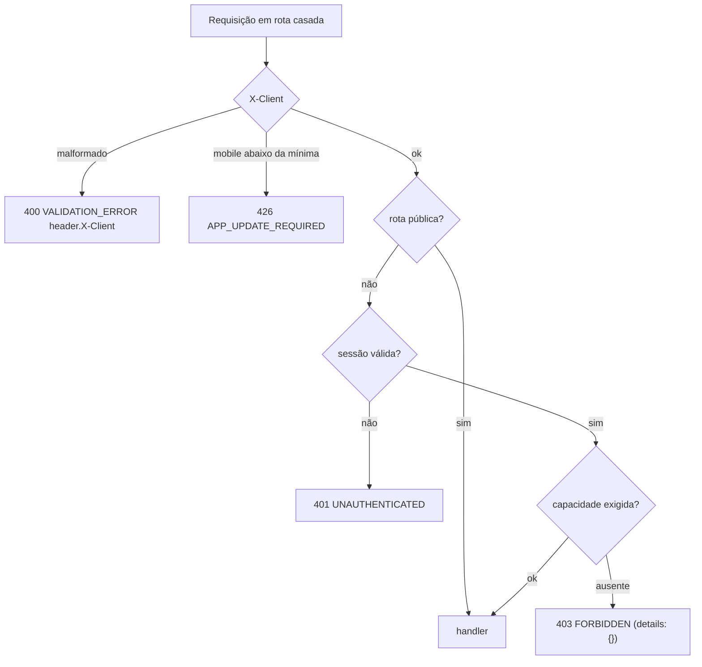

# API de identidade (autenticação, conta, cliente e capacidades)

Documenta o que o código implementa em `api/src/modules/identity/presentation/http` e nos guards de identity. Decisões: `docs/adr/0005-autenticacao-autorizacao-demo.md` e `docs/adr/0011-app-mobile-ios.md`. Convenções gerais (prefixo `/api`, formato de erro, precedência) estão em `docs/api/finance.md`.

## Autenticação

Bearer token opaco: `Authorization: Bearer <token>`, emitido por `POST /api/auth/login`. Rotas públicas: login, logout e `/api/demo/*`.

### Cabeçalho `X-Client`

Identifica o cliente. Opcional.

| Valor | Cliente |
|---|---|
| ausente | `WEB` (o web não envia o cabeçalho) |
| `mobile/<MAJOR.MINOR.PATCH>` (ex.: `mobile/1.0.0`, cada parte com 1 a 4 dígitos) | `MOBILE` |
| qualquer outra coisa | 400 |

- **Malformado: 400** `VALIDATION_ERROR` com `details.fields = [{ "field": "header.X-Client", "code": "INVALID_FORMAT", "message": "Cabeçalho X-Client em formato inválido." }]`.
- **Versão abaixo da mínima: 426** `APP_UPDATE_REQUIRED`. A mínima vem de `MOBILE_MIN_VERSION` (padrão `1.0.0`); `storeUrl` vem de `MOBILE_STORE_URL` (ou `null`).

```json
{
  "code": "APP_UPDATE_REQUIRED",
  "message": "Atualize o aplicativo para continuar.",
  "details": { "minimumVersion": "1.2.0", "storeUrl": "https://apps.apple.com/br/app/id1234567890" }
}
```

- A verificação roda em **todas as rotas casadas**, inclusive as públicas (login, logout, `/api/demo/*`), antes da autenticação: um 426 vale mesmo sem token. Rotas inexistentes (404 `ROUTE_NOT_FOUND`) não passam por ela.
- `X-Client` não é controle de segurança: informá-lo não concede privilégio.
- Precedência numa rota protegida: `MALFORMED_JSON`/413 > 400 `X-Client` > 426 > 401 > 403 `PASSWORD_CHANGE_REQUIRED` > 403 `FORBIDDEN` > 429 > 400 > 404 > 422.

### `Cache-Control: no-store`

`POST /api/auth/login` e `GET /api/auth/me` respondem `Cache-Control: no-store`.

### Objeto `user` (login e `me`)

```json
{
  "id": "0192f3a4-6b1c-7d2e-8f90-a1b2c3d4e5f6",
  "name": "Maria",
  "email": "maria@example.com",
  "role": "USER",
  "mustChangePassword": false,
  "accountKind": "REGULAR",
  "capabilities": ["MANAGE_EXPENSES", "CHANGE_OWN_PASSWORD", "UPDATE_OWN_PROFILE"]
}
```

- `accountKind`: `REGULAR` ou `SHOWCASE` (conta de demonstração do app). Campo acrescentado; clientes antigos podem ignorá-lo.
- `capabilities`: calculada pelo domínio (`AccountCapabilities`) a partir de tipo e nível da conta. Os clientes decidem a visibilidade de ações por ela, não por `role`.

| Conta | `capabilities` |
|---|---|
| `REGULAR` + `ADMIN` | `MANAGE_USERS`, `MANAGE_EXPENSES`, `CHANGE_OWN_PASSWORD`, `UPDATE_OWN_PROFILE` |
| `REGULAR` + `USER` | `MANAGE_EXPENSES`, `CHANGE_OWN_PASSWORD`, `UPDATE_OWN_PROFILE` |
| `SHOWCASE` | `MANAGE_EXPENSES` |

## Endpoints

| Método | Rota | Acesso | Sucesso |
|---|---|---|---|
| POST | `/api/auth/login` | pública | 200 |
| POST | `/api/auth/logout` | pública | 204 |
| GET | `/api/auth/me` | sessão (permitida com troca de senha pendente) | 200 |
| PUT | `/api/account/password` | sessão (permitida com troca pendente); capacidade `CHANGE_OWN_PASSWORD` | 200 |
| PUT | `/api/account/profile` | sessão; capacidade `UPDATE_OWN_PROFILE` | 200 |
| GET, POST | `/api/admin/users` | capacidade `MANAGE_USERS` | 200 / 201 |
| GET, PUT | `/api/admin/users/:id` | `MANAGE_USERS` | 200 |
| POST | `/api/admin/users/:id/deactivate`, `/reactivate`, `/password-reset` | `MANAGE_USERS` | 200 |

### POST /api/auth/login

Corpo estrito: `{ "email": string, "password": string }`. `X-Client` opcional. Sem alias de e-mail.

```json
{
  "user": { "id": "...", "name": "Maria", "email": "maria@example.com", "role": "USER",
            "mustChangePassword": false, "accountKind": "REGULAR",
            "capabilities": ["MANAGE_EXPENSES", "CHANGE_OWN_PASSWORD", "UPDATE_OWN_PROFILE"] },
  "session": { "token": "<token opaco>", "expiresAt": "2026-11-09T13:00:00.000Z" }
}
```

Erros (precedência): 400 `X-Client` > 426 > 429 `TOO_MANY_ATTEMPTS` (`details.retryAfterSeconds`) > 400 corpo > 401 `INVALID_CREDENTIALS`. A conta de demonstração não alimenta nem consulta o bloqueio por e-mail (5 falhas em 15 min); o limite por IP continua valendo.

### POST /api/auth/logout

Sem corpo; idempotente. 204. Erros: 400 `X-Client`, 426.

### GET /api/auth/me

Devolve o objeto `user`. Erros: 400 `X-Client`, 426, 401 `UNAUTHENTICATED`.

### PUT /api/account/password

Corpo estrito: `{ "currentPassword": string, "newPassword": string }`. Encerra as outras sessões do usuário (inclusive as do app).

Erros, na ordem: 400 `X-Client` > 426 > 401 > **403 `FORBIDDEN`** > 429 > 400 corpo (`currentPassword: INCORRECT`; `newPassword: REQUIRED`, `TOO_SHORT`, `TOO_LONG`, `SAME_AS_CURRENT`).

Para a conta `SHOWCASE` (sem `CHANGE_OWN_PASSWORD`) a resposta é sempre 403, **antes** de conferir a senha atual: nunca vira 400 `INCORRECT` nem conta tentativa.

### PUT /api/account/profile

Corpo estrito: `{ "name": string }`. A conta `SHOWCASE` (sem `UPDATE_OWN_PROFILE`) recebe 403 `FORBIDDEN`: não renomeia.

### Gestão de usuários (`/api/admin/users`)

Só `MANAGE_USERS` (REGULAR + ADMIN); os demais recebem 403 `FORBIDDEN`. Criar: `{ name, email, role, password }`; editar: `{ name, email, role }`; redefinir senha: `{ password }`. A conta de demonstração não aparece nem é endereçável (404 `USER_NOT_FOUND`).

**E-mails `.invalid` são reservados** (demo, conta de demonstração, marcador do primeiro administrador): criar (`POST`) ou editar (`PUT`) um usuário com e-mail terminado em `.invalid` responde **400 `VALIDATION_ERROR`** com `fields: [{ "field": "email", "code": "INVALID_FORMAT", ... }]`, e não mais 409 `EMAIL_TAKEN`. `EMAIL_TAKEN` (409) continua para e-mail comum já usado. O primeiro administrador (`ADMIN_EMAIL`) também recusa `.invalid`.

## Erros

| HTTP | `code` | Quando | `details` |
|---|---|---|---|
| 400 | `VALIDATION_ERROR` | Corpo ou cabeçalho inválido (inclui `X-Client` malformado e e-mail `.invalid` na gestão) | `{ fields: [...] }` |
| 401 | `UNAUTHENTICATED` | Token ausente, inválido ou expirado | - |
| 401 | `INVALID_CREDENTIALS` | Login inválido (inclusive e-mail inexistente, conta inativa, e-mail demo reservado) | - |
| 403 | `PASSWORD_CHANGE_REQUIRED` | Troca de senha pendente em rota que não a permite | - |
| 403 | `FORBIDDEN` | Capacidade ausente | **`{}`** (sempre objeto vazio) |
| 404 | `USER_NOT_FOUND` | Usuário inexistente na gestão | - |
| 409 | `EMAIL_TAKEN` | E-mail comum já usado (criar/editar usuário) | `fields` |
| 422 | `CANNOT_TARGET_SELF`, `LAST_ADMIN` | Regras de administração | - |
| 426 | `APP_UPDATE_REQUIRED` | `X-Client: mobile/<v>` abaixo de `MOBILE_MIN_VERSION` | `{ minimumVersion, storeUrl }` |
| 429 | `TOO_MANY_ATTEMPTS` | Limite de tentativas | `{ retryAfterSeconds }` |

`403 FORBIDDEN` sempre traz `"details": {}`, nunca `null` nem ausente.

## Configuração relevante (API)

| Variável | Regra |
|---|---|
| `MOBILE_MIN_VERSION` | semver `X.Y.Z`; padrão `1.0.0` |
| `MOBILE_STORE_URL` | URL `https://`; vai em `details.storeUrl` |
| `TRUST_PROXY` | obrigatória em produção; só IP(s)/sub-rede do nginx (recusa `true`, número, `loopback`, `uniquelocal`); vale também para o seed |
| `SHOWCASE_ACCOUNT_PASSWORD` | lida só pelo seed; vazia/ausente desliga (inativa) a conta `demo@showcase.invalid` |
| `MAINTENANCE_INTERVAL_MS` | `0` desliga também a limpeza diária da conta de demonstração |

## Conta de demonstração (`SHOWCASE`)

- E-mail `demo@showcase.invalid`; senha definida por `SHOWCASE_ACCOUNT_PASSWORD` (1 a 72 caracteres, sem o mínimo de 8 das demais contas; só o seed a define).
- Cria, edita, exclui e paga os próprios lançamentos (`MANAGE_EXPENSES`); não troca senha nem perfil (403).
- Os lançamentos e cartões da conta são apagados todo dia às 03:00 America/Sao_Paulo (tarefa diária da manutenção, também executada uma vez na subida do processo HTTP, de forma idempotente).

## Exposição pelo nginx

Em produção a API fica atrás do nginx: o listener público bloqueia `/api/admin/*` e `/api/demo/*` (404); o web chama a API por um listener interno. Checklist N1-N10 no README raiz e no ADR 0011, seção 6.1.

## Diagrama: pré-políticas e capacidade


